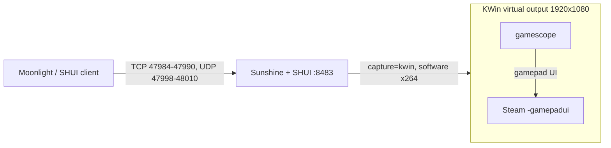

# Steam Headless 2 — BC-250 build

Thin, reproducible layer on top of `josh5/steam-headless:2` that turns the
container into a SteamOS-like game console for an **AMD BC-250 (Cyan Skillfish,
RADV GFX1013)** host: gamescope + Steam gamepad UI, software encoding, no VAAPI.

Upstream image is **not** patched in place — everything we change lives under
`rootfs/` and is copied over the stock filesystem.



## What this image adds

| Path | Purpose |
|---|---|
| `rootfs/usr/local/bin/gamescope-no-force-grab` | Runs the stock gamescope launcher with `--force-grab-cursor` removed. That flag means *"always use relative mouse mode"*, which puts a second blinking cursor in the screen centre and makes every click land there instead of on the visible cursor. |
| `rootfs/etc/systemd/system/steam-headless-gamescope.service.d/50-no-force-grab-cursor.conf` | Drop-in that only overrides `ExecStart`; all other directives still come from the upstream unit. |
| `rootfs/usr/local/sh-init.d/10-seed-sunshine-config.sh` | On boot, seeds `~/.config/sunshine/{sunshine.conf,apps.json}` from the defaults below, only if absent. |
| `rootfs/usr/share/steam-headless-custom/sunshine.conf` | `encoder = software`, `capture = kwin`, `upnp = disabled`, no display-mode prep command. |
| `rootfs/usr/share/steam-headless-custom/apps.json` | Two stream-only tiles: `Desktop` and `Steam \| Game Mode` (no `cmd`, so nothing spawns a second Steam). |

Runtime knobs live in `docker-compose.yml`:

| Env | Value | Why |
|---|---|---|
| `STEAM_HEADLESS_SESSION_MODE` | `gaming` | boot straight into gamescope + gamepad UI |
| `SHUI_ENCODER` | `software` | GFX1013 has no working VAAPI; SHUI otherwise crash-loops on `vah264enc` |
| `SUNSHINE_ENABLE_AUTO_CONFIG` | `false` | auto-config rewrites `encoder = vaapi` and re-adds the display-mode prep on every boot |
| `SUNSHINE_ENABLE_AUTO_DISPLAY_MODE` | `false` | drops the set-display-mode prep/undo from session start |

## Requirements

- Linux host, cgroup v2, Docker ≥ 24 with compose v2
- `/dev/dri/renderD128`, `/dev/uinput`, `/dev/uhid`, `/dev/fuse`
- host networking (Moonlight discovery + WebRTC need it)

## Quick start

```bash
git clone git@github.com:Naster17/steam-headless-bc250.git
cd steam-headless-bc250

cp .env.example .env          # set SH2_DIR / PUID / PGID / TZ
mkdir -p "$(grep ^SH2_DIR .env | cut -d= -f2)"/{data/home,games,state,journal}

docker compose up -d --build
docker compose logs -f        # first boot prints the SHUI bootstrap password
```

Open `https://<host>:8483`, sign in as `steamheadless` with the temporary
password, set the permanent one, then connect a Moonlight client and pick a tile.

## Verify

```bash
make verify     # container, units, session mode, cursor flag, portal, GameStream
make health     # raw steam-headless-healthcheck output
```

Raw checks, if you prefer:

```bash
docker exec steam-headless /usr/local/bin/steam-headless-healthcheck   # health=healthy checks=33
docker exec steam-headless cat /run/steam-headless/session/state.json  # currentMode: gaming
docker exec steam-headless ss -lnt | grep -E '47984|47989|47990|48010'
```

## Operating notes

- **Software encoding only.** One stream ≈ one CPU core. Lower the client
  resolution/FPS before blaming the network.
- **Sunshine is single-session.** A client that aborts mid-handshake leaves the
  "app running" flag set: later attempts fail with `Error 400` or
  `RTSP error 111`. Reset with
  `docker exec steam-headless systemctl restart steam-headless-sunshine`.
- **Session switching** is CLI-only (no SHUI toggle, and a Sunshine app cannot do
  it — it runs unprivileged):
  `docker exec steam-headless steam-headless-session-mode desktop|gaming`.
  It restarts Steam, so an active stream drops.
- **Only Steam and its children** inherit the gamescope environment. Apps started
  by Sunshine or by SHUI land on KWin and are invisible in gaming mode — install
  them as non-Steam shortcuts inside Steam instead.
- Boot-time config seeding never overwrites an existing
  `~/.config/sunshine/sunshine.conf` or `apps.json`.

## Repository layout

```
Dockerfile
docker-compose.yml
Makefile                  # up/build/logs/mode-*/reset-sunshine/backup/verify
scripts/health.sh         # read-only readiness check (make verify)
docs/operations.md        # full ops manual: ports, Sunshine resets, modes, troubleshooting
CHANGELOG.md
rootfs/
  etc/systemd/system/steam-headless-gamescope.service.d/50-no-force-grab-cursor.conf
  usr/local/bin/gamescope-no-force-grab
  usr/local/sh-init.d/10-seed-sunshine-config.sh
  usr/share/steam-headless-custom/{sunshine.conf,apps.json}
```

## License / credits

Built on [`josh5/steam-headless`](https://github.com/Steam-Headless/docker-steam-headless)
and [gamescope](https://github.com/ValveSoftware/gamescope). This repository only
carries the deltas listed above.
