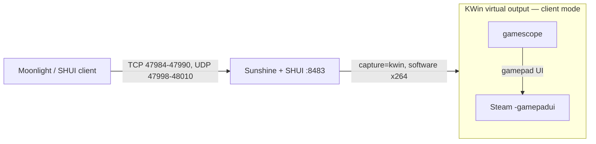
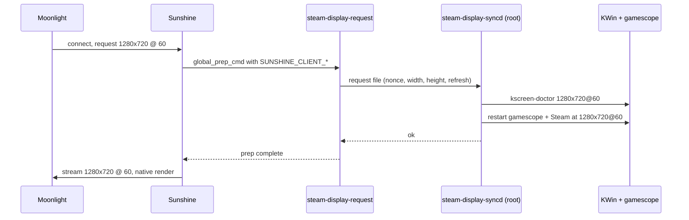

# Steam Headless 2 — BC-250 build

Thin, reproducible layer on top of `josh5/steam-headless:2` that turns the
container into a SteamOS-like game console for an **AMD BC-250 (Cyan Skillfish,
RADV GFX1013)** host: gamescope + Steam gamepad UI, software encoding, no VAAPI.

Upstream image is **not** patched in place — everything we change lives under
`rootfs/` and is copied over the stock filesystem.



## What this image adds

| Path | Purpose |
|---|---|
| `rootfs/usr/local/bin/gamescope-no-force-grab` | Runs the stock gamescope launcher with `--force-grab-cursor` removed. That flag means *"always use relative mouse mode"*, which puts a second blinking cursor in the screen centre and makes every click land there instead of on the visible cursor. |
| `rootfs/etc/systemd/system/steam-headless-gamescope.service.d/50-no-force-grab-cursor.conf` | Drop-in that only overrides `ExecStart`; all other directives still come from the upstream unit. |
| `rootfs/usr/local/sh-init.d/10-seed-sunshine-config.sh` | On boot, seeds `~/.config/sunshine/{sunshine.conf,apps.json}` from the defaults below, only if absent. |
| `rootfs/usr/share/steam-headless-custom/sunshine.conf` | `encoder = software`, `capture = kwin`, `upnp = disabled`, plus the managed `global_prep_cmd` that applies each Moonlight client's requested display mode. |
| `rootfs/usr/share/steam-headless-custom/apps.json` | Two stream-only tiles: `Desktop` and `Steam \| Game Mode` (no `cmd`, so nothing spawns a second Steam). |
| `rootfs/usr/local/bin/steam-display-request` + `rootfs/usr/local/sbin/steam-display-syncd` + `rootfs/etc/systemd/system/steam-display-syncd.service` | **Dynamic per-client display mode.** Sunshine runs the unprivileged request helper at stream start; the root daemon applies `SUNSHINE_CLIENT_WIDTH/HEIGHT/FPS` to the KWin virtual output and, in gaming mode, relaunches gamescope and Steam with the same output size and refresh. Moonlight's 720p60, 1080p90 or 1280x800 request therefore changes what the game actually renders, not just what Sunshine scales. |
| `rootfs/usr/local/bin/steam-controller-patch` + `rootfs/usr/local/sh-init.d/20-patch-steam-controller-base.sh` | Adds a **500 ms long-press on Select → Quick Access Menu** (`controller_action system_key_1`, the right-hand panel with Performance/Friends) to the default Big Picture, Desktop and per-game Xbox layouts. Useful when the controller's Guide button is unreliable, since Steam's own chords all require Guide. Every patched file keeps its exact original byte size — Steam verifies `controller_base` against its depot manifest and re-extracts mismatching files. Re-applied on every boot, because a Steam client update restores the stock files. |
| `rootfs/usr/local/bin/steam-gpu-load` + `rootfs/etc/systemd/system/steam-gpu-load.service` | Publishes GPU utilisation. The BC-250 driver answers `gpu_busy_percent` with `EOPNOTSUPP`, and the `gpu_metrics` table reports `0xFFFF` for `average_gfx_activity`, which MangoHud divides by 100 and renders as `655%`. The daemon rewrites both nodes inside the container from the driver's own centipercent value, falling back to per-`drm-client-id` `drm-engine-gfx` deltas. |
| `rootfs/usr/local/bin/steam-cpu-freq` + `rootfs/etc/systemd/system/steam-cpu-freq.service` | Publishes the CPU clock. The BC-250 kernel registers no cpufreq driver, so `cpu*/cpufreq/scaling_cur_freq` does not exist and the overlay shows a constant. The service shadows each `cpuN` directory with a view that adds those files, fed from `/proc/cpuinfo`. |

Runtime knobs live in `docker-compose.yml`:

| Env | Value | Why |
|---|---|---|
| `STEAM_HEADLESS_SESSION_MODE` | `gaming` | boot straight into gamescope + gamepad UI |
| `STEAM_HEADLESS_DYNAMIC_DISPLAY` | `true` | apply each Moonlight client's resolution/refresh to KWin and gamescope; `false` keeps one fixed mode |
| `SHUI_ENCODER` | `software` | GFX1013 has no working VAAPI; SHUI otherwise crash-loops on `vah264enc` |
| `SUNSHINE_ENABLE_AUTO_CONFIG` | `false` | auto-config rewrites `encoder = vaapi` and re-adds the display-mode prep on every boot |
| `SUNSHINE_ENABLE_AUTO_DISPLAY_MODE` | `false` | keeps upstream's prep/undo out of the config; dynamic display is driven by our own managed prep command |

## Requirements

- Linux host, cgroup v2, Docker ≥ 24 with compose v2
- `/dev/dri/renderD128`, `/dev/uinput`, `/dev/uhid`, `/dev/fuse`
- host networking (Moonlight discovery + WebRTC need it)

## Quick start

```bash
git clone git@github.com:Naster17/steam-headless-bc250.git
cd steam-headless-bc250

cp .env.example .env          # set SH2_DIR / PUID / PGID / TZ
make dirs                     # host dirs + metric seed files compose mounts

docker compose up -d --build
docker compose logs -f        # first boot prints the SHUI bootstrap password
```

Open `https://<host>:8483`, sign in as `steamheadless` with the temporary
password, set the permanent one, then connect a Moonlight client and pick a tile.

## Verify

```bash
make verify     # container, units, session mode, cursor flag, display daemon, portal, GameStream
make health     # raw steam-headless-healthcheck output
```

Raw checks, if you prefer:

```bash
docker exec steam-headless /usr/local/bin/steam-headless-healthcheck   # health=healthy checks=33
docker exec steam-headless cat /run/steam-headless/session/state.json  # currentMode: gaming
docker exec steam-headless ss -lnt | grep -E '47984|47989|47990|48010'
```

## Session modes

The container boots into the mode selected by `STEAM_HEADLESS_SESSION_MODE`
(this deployment: `gaming`). The two targets are mutually exclusive:

| Mode | What runs on the virtual display | Use it for |
|---|---|---|
| `gaming` | KWin → gamescope → Steam Gamepad UI | playing, Moonlight streaming, couch/console use |
| `desktop` | KWin → KDE Plasma | installing apps and launchers, adding non-Steam shortcuts, browser/maintenance |

Switch the live session — CLI only, there is no SHUI toggle:

```bash
# Gamescope + Steam Gamepad UI
docker exec steam-headless steam-headless-session-mode gaming

# KDE Plasma desktop
docker exec steam-headless steam-headless-session-mode desktop
```

The repo wrappers switch and then print the resulting state:

```bash
make mode-gaming     # -> {"currentMode":"gaming","state":"ready",...}
make mode-desktop    # -> {"currentMode":"desktop","state":"ready",...}
```

Check the current mode at any time:

```bash
docker exec steam-headless cat /run/steam-headless/session/state.json
```

Notes:

- Switching restarts Steam, so an active Moonlight stream drops. Reconnect once
  `state` is `ready`.
- Use `desktop` to install launchers and add non-Steam shortcuts through the
  Steam UI; the Gamepad UI has no shortcut editor. Launch games from the
  Gamepad UI in `gaming`.
- The [per-client display mode](#dynamic-per-client-display-mode) works in both:
  in `gaming` it also relaunches gamescope at the client's resolution/refresh;
  in `desktop` only the KWin output changes.
- To change the boot mode, edit `STEAM_HEADLESS_SESSION_MODE` in
  `docker-compose.yml` and recreate the container.

## Operating notes

- **Software encoding only.** One stream ≈ one CPU core. Lower the client
  resolution/FPS before blaming the network.
- **Sunshine is single-session.** A client that aborts mid-handshake leaves the
  "app running" flag set: later attempts fail with `Error 400` or
  `RTSP error 111`. Reset with
  `docker exec steam-headless systemctl restart steam-headless-sunshine`.
- **Session switching** is CLI-only (no SHUI toggle, and a Sunshine app cannot do
  it — it runs unprivileged). Commands, mode differences and the state check:
  [Session modes](#session-modes). It restarts Steam, so an active stream drops.
- **Only Steam and its children** inherit the gamescope environment. Apps started
  by Sunshine or by SHUI land on KWin and are invisible in gaming mode — install
  them as non-Steam shortcuts inside Steam instead. See
  [docs/steam-shortcuts.md](docs/steam-shortcuts.md) for the binary
  `shortcuts.vdf` rules, or
  [docs/prism-launcher.md](docs/prism-launcher.md) for the Prism 9.x example.
- Boot-time config seeding never overwrites an existing
  `~/.config/sunshine/sunshine.conf` or `apps.json`.
- **Controller:** holding `Select` for 500 ms opens Steam's Quick Access Menu
  on any controller whose Guide button is flaky; a short `Select` press still goes
  to the game. The binding lives in Steam's default layouts, so it applies to the
  gamepad UI, the desktop and games alike — see
  [docs/operations.md](docs/operations.md#9-controller-long-press-select--quick-access-menu).

## Dynamic per-client display mode

The virtual display is no longer fixed. When a Moonlight client starts a
stream, Sunshine runs a global prep command carrying that client's requested
resolution and FPS. A small root daemon applies the mode to KWin and, in gaming
mode, relaunches gamescope and Steam with the same output size and refresh. The
game renders at the client's mode; Sunshine is no longer upscaling a fixed
1080p desktop.



What happens on a connection:

| Situation | Behaviour |
|---|---|
| Mode differs from the current desktop/gamescope mode | KWin switches, Steam stops, gamescope relaunches at the new size/refresh, Steam starts again |
| Same mode as the running session | Nothing restarts — reconnecting does not close a running game |
| Desktop mode (`steam-headless-session-mode desktop`) | Only the KWin output changes; Plasma apps resize immediately |
| Daemon or mode helper fails | Stream still starts (the prep command is fail-soft); Sunshine scales the previous mode. Check the daemon journal |

Practical notes:

- The first frame after a mode change arrives a few seconds later (typically
  5–20 s: Steam is stopped gracefully, gamescope is relaunched and Steam starts
  again). Moonlight shows its normal "Starting…" state during this.
- Changing the mode closes a game that is already running. That is inherent:
  gamescope's output size and refresh are fixed when it starts, so a native
  render at a different mode requires a new gamescope.
- KDE persists the selected mode, so the last mode is also what the next
  container boot restores. The next client request replaces it.
- The helper seeds common 16:9, 16:10, ultrawide and MacBook modes and adds a
  custom KWin mode for anything else within 320–7680 × 200–4320 and 24–240 Hz.
  A Steam Deck `1280x800@60` request therefore renders in 16:10, without
  letterboxing.
- Software encoding still sets the ceiling: 1080p90 is roughly one CPU core on
  this APU, and 1080p120 or 4K is a CPU problem rather than a display-mode
  problem. 720p60 and 1080p60/90 are the useful range on the BC-250.

Disable it without removing the image features by setting
`STEAM_HEADLESS_DYNAMIC_DISPLAY=false` in `.env` and recreating the container;
the boot hook then removes the managed prep command.

Inspect or debug:

```bash
docker exec steam-headless cat /run/steam-headless/dynamic-display   # enabled|disabled
docker exec steam-headless grep global_prep_cmd \
  /home/steamheadless/.config/sunshine/sunshine.conf
docker exec steam-headless journalctl -u steam-display-syncd -f
docker exec steam-headless journalctl -u steam-headless-sunshine -f  # "Executing Do Cmd"
```

## Custom boot / suspend animations

Personal media is deliberately **not** in this repository. Steam reads custom
startup movies from a directory inside the home volume, and every `.webm` there
shows up under *Settings → Customization → Startup movie*:

```bash
# host path (SH2_DIR/data/home is mounted at /home/steamheadless)
$SH2_DIR/data/home/.local/share/Steam/config/uioverrides/movies/
```

Drop the files in as the `steamheadless` user (uid 1000) and restart Steam once so
the list and thumbnails refresh. SteamOS names its suspend clips
`deck-suspend-animation.webm` (out of game) and
`deck-suspend-animation-from-throbber.webm` (while a game runs); the boot clip is
whatever file you select in the customization page.

## Repository layout

```
Dockerfile
docker-compose.yml
Makefile                  # up/build/logs/mode-*/reset-sunshine/backup/verify
.env.example              # copy to .env
.dockerignore             # keep VCS, docs and local data out of the build context
LICENSE                   # MIT for this layer; upstream projects keep theirs
scripts/health.sh         # read-only readiness check (make verify)
docs/operations.md        # full ops manual: ports, Sunshine resets, modes, troubleshooting
docs/steam-shortcuts.md   # binary shortcuts.vdf, appid, verification
docs/prism-launcher.md    # Prism 9.x, offline account, Steam shortcut
CHANGELOG.md
rootfs/
  etc/systemd/system/
    steam-headless-gamescope.service.d/50-no-force-grab-cursor.conf
    steam-gpu-load.service
    steam-cpu-freq.service
    steam-display-syncd.service
  usr/local/bin/
    gamescope-no-force-grab
    steam-controller-patch
    steam-cpu-freq
    steam-display-request
    steam-gpu-load
  usr/local/sbin/steam-display-syncd
  usr/local/sh-init.d/{10-seed-sunshine-config.sh,20-patch-steam-controller-base.sh,30-manage-sunshine-display-prep.sh}
  usr/share/steam-headless-custom/{sunshine.conf,apps.json}
```

## License / credits

Built on [`josh5/steam-headless`](https://github.com/Steam-Headless/docker-steam-headless)
and [gamescope](https://github.com/ValveSoftware/gamescope). This repository only
carries the deltas listed above. The layer in this repository is MIT-licensed;
see [`LICENSE`](LICENSE). The upstream projects keep their own licenses.
