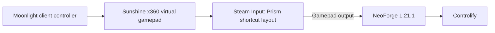

# Minecraft controller support (NeoForge 1.21.1)

This is the controller setup used by the live `1.21.1` Prism instance. It covers
the recommended mod, the Steam Input layout, and the container-specific input
details.

| Item | Value |
|---|---|
| Prism instance | `1.21.1` |
| Minecraft | `1.21.1` |
| NeoForge | `21.1.265` |
| Mods directory | `.../PrismLauncher/instances/1.21.1/minecraft/mods/` |
| Mod | **Controlify** `3.0.1+lts+1.21.1-neoforge.jar` |
| Required library | **YACL** `3.8.2+1.21.1-neoforge` (`YetAnotherConfigLib`) |
| Steam shortcut appid | `<appid>` (see [site.md](site.md)) |
| Steam userdata | `<SteamID3>` (see [site.md](site.md)) |
| Fallback mod | MidnightControls `1.10.0.1-neoforge` |

## Why Controlify

- Native NeoForge support; the 1.21.x build is a NeoForge-specific jar.
- Controller-first and Steam Deck-oriented.
- Configurable controller detection, virtual mouse/UI navigation and button
  prompts.
- It sees the Steam Input virtual Xbox pad as a normal gamepad.
- Actively maintained; the `3.0.1+lts` build is the long-term build for the
  1.21.x line.
- Controlify `3.0.1+lts` requires YACL `[3.8,4)`; the live instance uses
  `3.8.2+1.21.1-neoforge`.

MidnightControls is the fallback if a modpack conflicts with Controlify. It also
has a NeoForge build for 1.21.1, but is less Steam-oriented.

Do not use keyboard/mouse emulation for Minecraft if a controller mod is an
option. The launcher UI uses the mouse; the game uses the controller.

## Input path in this container



The container already exposes the required input devices:

- `/dev/uinput`, `/dev/uhid`, `/dev/fuse` and `/dev/dri/renderD128` are mapped in
  `docker-compose.yml`.
- `/dev/input` is a private tmpfs; the container's virtual input devices appear
  there.
- Steam runs `-gamepadui -steamos3 -steampal`; the controller is handled by
  Steam Input.
- `steam-controller-patch` adds the 500 ms long-press **Select → Steam QAM** to
  the stock layouts. A short Select press still reaches the game.
- `gamescope-no-force-grab` removes `--force-grab-cursor`, so the mouse used for
  the Prism UI has a visible absolute cursor.

Steam treats Prism and its Minecraft child as one shortcut, so the Prism
shortcut's controller layout applies to the game.

## Install Controlify

Use Prism's Modrinth integration:

1. Open the `1.21.1` instance → **Mods → Add mod**.
2. Search **Controlify** and select the **1.21.1 NeoForge** build
   `3.0.1+lts`.
3. Add **YACL** (YetAnotherConfigLib); it is a required dependency. The live
   instance uses `3.8.2+1.21.1-neoforge`.
4. Let Prism finish the downloads, then restart Prism if the Mods tab does not
   refresh.

Manual installation uses the instance's `mods/` directory:

```text
$SH2_DIR/data/home/.local/share/PrismLauncher/instances/1.21.1/minecraft/mods/
/home/steamheadless/.local/share/PrismLauncher/instances/1.21.1/minecraft/mods/   # container path
```

Place the two jars there:

```text
controlify-3.0.1+lts+1.21.1-neoforge.jar
yet_another_config_lib_v3-3.8.2+1.21.1-neoforge.jar
```

The jars are user data and survive container recreation. They are not part of
the image.

## Steam Input setup

The Prism shortcut has its own Steam Input controller layout. Steam applies it
to the shortcut and its child processes (Prism and Minecraft). This is separate
from the mod: Controlify can only use a gamepad if Steam exposes one.

### Gamepad vs keyboard/mouse

| Layout | What Steam sends to the app | Result |
|---|---|---|
| **Keyboard (WASD) and Mouse** | Controller translated into keyboard/mouse events | Controlify sees no gamepad; the controller does nothing in Minecraft |
| **Gamepad** | Virtual Xbox pad | Controlify sees the pad and handles Minecraft |

Use **Gamepad**. The mouse for the Prism UI is Moonlight's mouse and is
independent of this layout; choosing Gamepad does not remove it. A trackpad
template is not needed on a standard Xbox-style controller.

### Set the layout

1. Open the Steam library and select the Prism shortcut (appid
   `3102825927`). Do not launch it.
2. Open the shortcut's controller settings:
   - gamepad UI: the **controller icon** on the game page, or the
     **Manage/gear** menu → **Controller**;
   - desktop UI: the **controller icon** on the game page, or right-click the
     shortcut → **Manage** → **Controller Layout**.
3. Open **Controller Layout → Browse Configs → Templates**.
4. Select **Gamepad** and apply it.

The setting is per-shortcut, stored in Steam's user data, and persists across
launches and container recreation. The UI shows the active layout; if it is not
Gamepad, change it. The shortcut's **Allow Desktop Configuration in Launcher**
option is not the game layout; it only controls the desktop layout while the
launcher is focused.

The startup shortcut is launched from the **Steam library UI**. On this client,
`steam -applaunch 3102825927` returns `AppError_9` for non-Steam shortcuts even
when the entry is valid; it is not a valid test.

`steam-controller-patch` adds a Steam-level long-press Select → QAM. Do not bind
long-press Select inside Controlify; use another button for its settings/menu.
Short Select presses still reach the game.

## Verify

Check the installed jars from the host:

```bash
MODS="$SH2_DIR/data/home/.local/share/PrismLauncher/instances/1.21.1/minecraft/mods"
ls -l "$MODS"
sha512sum "$MODS"/*.jar
```

Launch from the Steam library UI, then check:

- the Prism shortcut's Steam Input layout is **Gamepad**;
- the NeoForge log shows Controlify loaded;
- Controlify's settings screen detects a controller;
- the controller works in-game and in the Controlify menus.

Useful logs:

```text
instances/1.21.1/minecraft/logs/latest.log
instances/1.21.1/minecraft/logs/debug.log
```

If the pad is not detected:

1. Verify the Prism shortcut's controller layout is **Gamepad**.
2. As a test, disable Steam Input for the Prism shortcut so the Sunshine virtual
   gamepad passes through directly.
3. Check that `mods/` contains both Controlify and YACL, not a Fabric-only jar.
4. Check for a second controller mod (MidnightControls/Controllable) and remove
   the duplicate.
5. Confirm the Minecraft version matches the jars; `3.5.3` Controlify is for
   26.x, not 1.21.1.

## Version matrix

| NeoForge Minecraft | Controlify | Dependency | MidnightControls fallback |
|---|---|---|---|
| 1.21.1 | `3.0.1+lts+1.21.1-neoforge.jar` | YACL 3.8.2 | `1.10.0.1-neoforge` |
| 1.21.8 | `3.0.1+lts+1.21.8-neoforge.jar` | YACL | `1.11.2-neoforge` |
| 1.21.11 | `3.0.1+lts+1.21.11-neoforge.jar` | YACL | `1.12.0+1.21.11-neoforge` + MidnightLib |
| 26.1 | `3.5.3+mc26.1-universal.jar` | check the version page | `1.12.1+26.1-neoforge` |

There is no Controlify or MidnightControls **NeoForge** build for 1.20.1; use
1.21.1 or newer for this setup.

## Common failures

| Symptom | Cause |
|---|---|
| Controlify not listed in game | jar in the wrong instance/mod loader, or Minecraft version mismatch |
| Game crashes at startup | missing YACL, wrong NeoForge/Minecraft build, or duplicate controller mods |
| Controller visible in Steam UI but not in game | Prism shortcut layout is keyboard/mouse; set it to Gamepad |
| Select opens Steam QAM instead of the mod menu | `steam-controller-patch` long-press interception; use a different Controlify button |
| Mouse works but controller does not | Steam Input is hiding the pad; use a Gamepad layout or disable Steam Input for the shortcut |
| Controlify menu opens but no input | controller detection issue; re-check the layout and the virtual pad |

## Maintenance

- Update Controlify through Prism; keep the jar matched to the Minecraft
  version. For 1.21.x use the `3.0.1+lts` line; for 26.x use `3.5.3`.
- The mods are in the home volume, not in the container image.
- The Steam Input layout is per-shortcut user data; it persists across container
  recreation.
- The controller patch only touches Steam's `controller_base` layouts; it does
  not add gamepad support to Prism itself. Prism is still mouse-driven.

## Related

- [Prism Launcher 9.x and offline accounts](prism-launcher.md)
- [Steam non-Steam shortcuts](steam-shortcuts.md)
- [Operations manual](operations.md)
